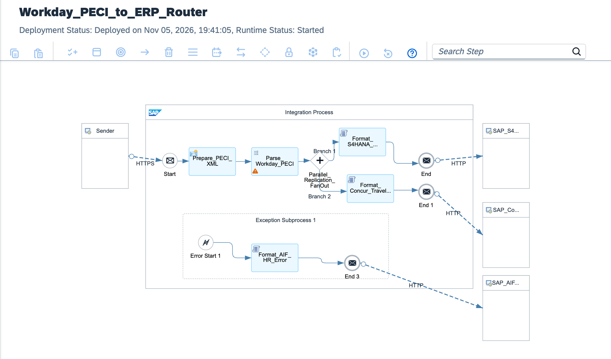

# Enterprise Global HR Modernization: Event-Driven Workday PECI Ingestion, XSLT 3.0 & Multicast to S/4HANA & Concur SCIM 2.0

[](https://www.sap.com)
[](https://www.sap.com)
[](https://www.workday.com)
[-purple?style=for-the-badge)](https://datatracker.ietf.org/doc/html/rfc7644)
[](https://www.sap.com)

---

## Executive Summary

Enterprise human capital management across multinational organizations requires instantaneous, synchronized propagation of worker lifecycle events (hires, role changes, cost center reassignments, terminations) across ERP financial cores and auxiliary enterprise clouds. Legacy architectures relied on unencrypted scheduled flat-file batch exports (CSV/FTP), leading to synchronization lag, orphaned travel accounts, and compliance breaches under GDPR and SOX frameworks.

This architecture establishes an **Event-Driven Global HR Orchestration Mesh**:
1. **Event-Driven PECI Ingestion:** Ingests Workday Payroll Effective Change Interface (PECI) delta streams and worker lifecycle notifications asynchronously via **SAP Advanced Event Mesh (AEM)** using AMQP 1.0 CloudEvents.
2. **High-Performance In-Flight XSLT 3.0 Transformation:** Slices hierarchical multi-megabyte HR worker snapshots in memory, executing deterministic schema transformation into normalized intermediate HR entities without JVM heap degradation.
3. **Decoupled Parallel Multicast Distribution:**
   * **Branch 1 (ERP Finance & Work Agreement):** Dispatches standard S/4HANA Workforce Person and Work Assignment records via **OData V4**, adhering strictly to Clean Core boundaries.
   * **Branch 2 (Corporate Travel & Identity):** Translates worker profiles into standardized **SCIM 2.0 (RFC 7644)** RESTful identity representations for automated provisioning and de-provisioning within **SAP Concur**.
4. **Forensic Dead-Letter Quarantining:** Automatically quarantines partial schema rejections or target API timeouts to a persistent dead-letter queue (DLQ) with correlation IDs, preventing broken worker states.

---

## Architecture Overview



### High-Level Topology

```text
[Workday Human Capital Management / PECI Integration]
          │
          │ CloudEvents 1.0 / AMQP 1.0
          ▼
[SAP Advanced Event Mesh (Topic: hr/worker/lifecycle/v1)]
          │
          ▼ AMQP Ingestion Adapter
[SAP Integration Suite: IF_GlobalHR_Workday_EventMesh_to_S4HANA_SCIM]
  │
  ├── 1. Context & Traceability Initialization (CM_Init_HR_Context):
  │    └─ Sets Worker Correlation GUID, Event Type (HIRE/TRANSFER/TERM), and ISO Timestamps
  │
  ├── 2. Transformation Engine (Transform_PECI_Worker_Envelope.xslt):
  │    ├─ In-memory XSLT 3.0 transformation from Workday PECI XML schema
  │    └─ Canonical normalizer: Extracts Demographics, Job Profile, Cost Center & Status
  │
  ├── 3. Data Sanitization & SCIM Normalizer (Sanitize_Worker_Payload.groovy):
  │    ├─ Strips sensitive unmapped PII (Zero-Trust masking)
  │    └─ Prepares dual payload representations (S/4HANA OData V4 and SCIM 2.0 JSON)
  │
  ├── 4. Parallel Multicast Router:
  │    │
  │    ├──► Branch A: S/4HANA Cloud (Workforce Management)
  │    │      ├─ Maps to SAP standard API_BUSINESS_PARTNER / Workforce Person
  │    │      └─ Outbound HTTP OData V4 Adapter (/sap/opu/odata4/sap/api_workforceperson/srvd_a2x)
  │    │
  │    └──► Branch B: SAP Concur (Travel & Expense Identity Mesh)
  │           ├─ Builds SCIM 2.0 User Resource (urn:ietf:params:scim:schemas:core:2.0:User)
  │           └─ Outbound HTTP SCIM Adapter (POST/PATCH /scim/v2/Users)
  │
  └── 5. Exception Subprocess (Format_HR_DLQ.groovy):
       └─ Catches transmission or validation faults and pushes to HR DLQ repository
```

---

## Technical Specifications

| Architectural Dimension | Legacy Batch CSV / SFTP Integration | Event-Driven HR Orchestration Mesh |
| :--- | :--- | :--- |
| **Ingestion Pattern** | Scheduled nocturnal polling (24h synchronization lag) | Near real-time event-driven streaming via SAP Event Mesh |
| **Data Format** | Flat pipe-delimited CSV / Positional TXT | Structured Workday PECI XML & CloudEvents 1.0 |
| **Transformation Runtime** | Heavy Java-based external ETL server | Native in-memory XSLT 3.0 & Groovy runtime |
| **Downstream Propagation** | Sequential, brittle point-to-point scripts | Non-blocking parallel multicast to ERP and Travel clouds |
| **Identity Standard** | Proprietary legacy user-management APIs | Strict RFC 7644 SCIM 2.0 RESTful schemas |
| **ERP Extensibility** | Invasive custom PA0001/PA0002 ABAP infotype code | 100% Clean Core compliant S/4HANA OData V4 standard |

---

## Target Payloads

### 1. S/4HANA Workforce Person OData V4 Entity
```json
{
  "WorkforcePersonExternalID": "EMP-994102",
  "BusinessPartnerRole": "BBP005",
  "Profile": {
    "FirstName": "Alexander",
    "LastName": "von Humboldt",
    "Email": "alexander.humboldt@enterprise.com",
    "Language": "EN"
  },
  "WorkAssignment": {
    "WorkAssignmentExternalID": "WA-994102-1",
    "JobTitle": "Senior Enterprise Architect",
    "CostCenter": "CC-DE-1010-ENG",
    "StartDate": "2026-11-01",
    "Status": "ACTIVE"
  }
}
```

### 2. SAP Concur SCIM 2.0 User Representation
```json
{
  "schemas": [
    "urn:ietf:params:scim:schemas:core:2.0:User",
    "urn:ietf:params:scim:schemas:extension:enterprise:2.0:User"
  ],
  "userName": "alexander.humboldt@enterprise.com",
  "name": {
    "givenName": "Alexander",
    "familyName": "von Humboldt"
  },
  "active": true,
  "emails": [
    {
      "value": "alexander.humboldt@enterprise.com",
      "type": "work",
      "primary": true
    }
  ],
  "urn:ietf:params:scim:schemas:extension:enterprise:2.0:User": {
    "employeeNumber": "EMP-994102",
    "costCenter": "CC-DE-1010-ENG",
    "organization": "Enterprise Architecture & Innovation"
  }
}
```

---

## Repository Structure

```text
├── README.md                                             # Enterprise architecture & operations runbook
├── sap-cpi-globalhr-eventmesh-runtime-architecture.png  # Integration flow runtime topology diagram
├── ADR-008-Event-Driven-HR-Decoupled-Multicast.md       # Architecture Decision Record
├── IF_GlobalHR_Workday_EventMesh_to_S4HANA_SCIM.zip      # Production iFlow runtime bundle export
├── cpi/
│   ├── mappings/
│   │   └── Transform_PECI_Worker_Envelope.xslt          # In-flight XSLT 3.0 transformation engine
│   └── scripts/
│       ├── Sanitize_Worker_Payload.groovy                # PII masking & dual payload builder
│       └── Format_HR_DLQ.groovy                          # HR exception dead-letter handler
├── tests/
│   ├── sample_valid_peci_event.xml                       # Compliant Workday PECI worker event
│   └── sample_malformed_worker_event.xml                 # Invalid event payload for DLQ trigger
└── .gitignore                                            # Git exclusion rules
```

---

## Verification & Deployment Runbook

### 1. Inbound Event Mesh Trigger Verification
Confirm the message queue subscriber status in **Monitor** ──► **Manage Integration Content**:
```text
Artifact: IF_GlobalHR_Workday_EventMesh_to_S4HANA_SCIM
State: Started
Adapter: AMQP (Connected to SAP Advanced Event Mesh)
```

### 2. Dispatched cURL Test (Simulated Event Ingestion)
Transmit a simulated Workday PECI CloudEvent to the test webhook endpoint:

```bash
curl -X POST \
  'https://<tenant-runtime>.cfapps.<region>[.hana.ondemand.com/http/hr/worker/peci/sync](https://.hana.ondemand.com/http/hr/worker/peci/sync)' \
  -H 'Content-Type: application/xml' \
  -H 'Authorization: Bearer <BTP_OAUTH_TOKEN>' \
  -H 'X-CloudEvents-Type: com.workday.peci.worker.updated.v1' \
  --data-binary '@tests/sample_valid_peci_event.xml'
```

### 3. Monitoring Trace
* Inspect execution under **Monitor Message Processing**.
* Confirm parallel execution across both multicast branches (`Branch_S4HANA` and `Branch_Concur_SCIM`).
* Verify properties `Worker_ID = EMP-994102`, `S4HANA_HTTP_Status = 201`, and `SCIM_HTTP_Status = 200`.

---

## Author

**Željko Popov**  
*Integration Architect | SAP Integration Suite & Clean Core Specialist*  
[GitHub Repositories](https://github.com/neurozeljko)
